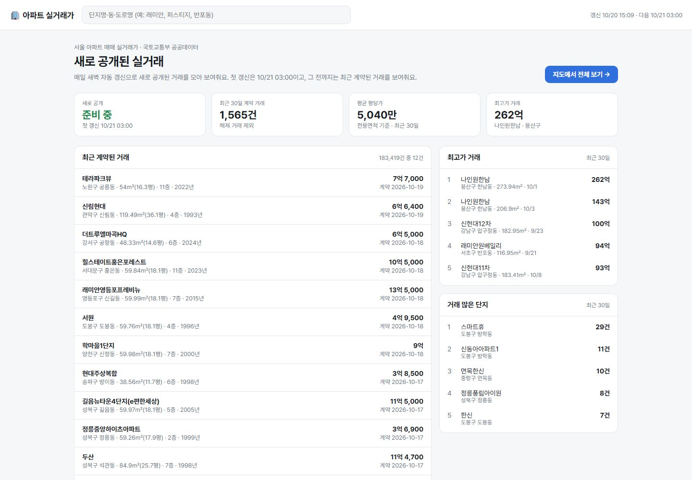
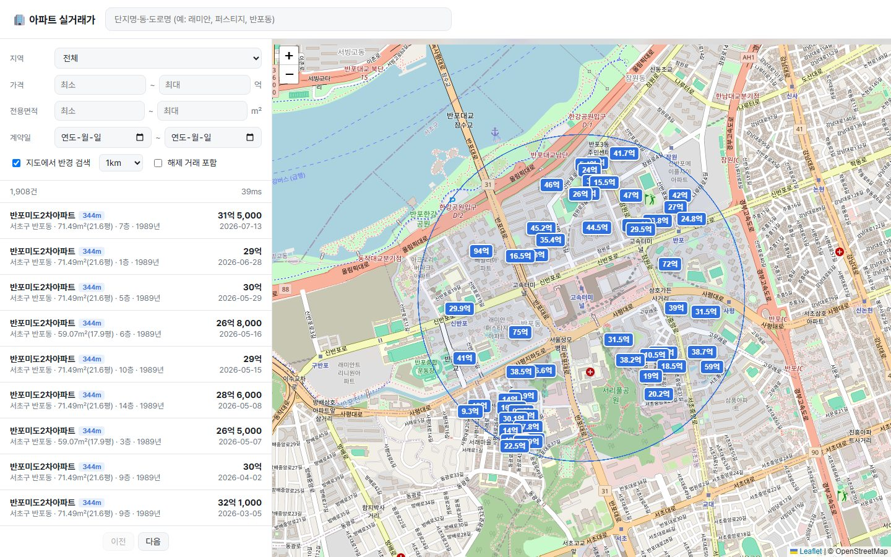
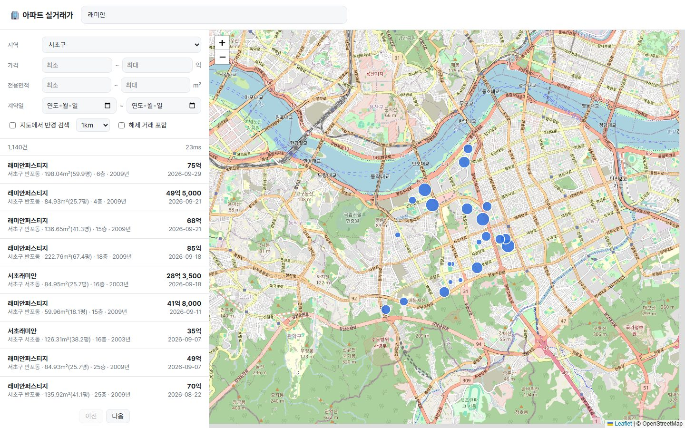
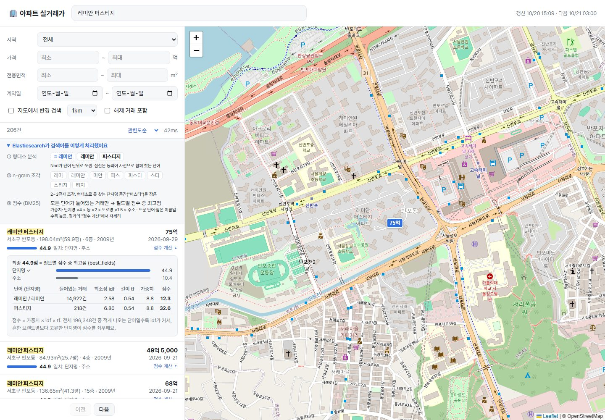

# 🏢 apt-search — 아파트 실거래가 검색 서비스

국토교통부 아파트 매매 실거래가 공공데이터를 Elasticsearch로 색인하고,
한국어 형태소 분석·자동완성·지오 검색·하이브리드 검색으로 **"원하는 거래를 바로 찾는"** 검색 서비스.

**Stack** · TypeScript (Node 22) · Elasticsearch 9.4 + Nori · Kibana · Fastify · Zod · Vitest



<sub>메인 화면(`/`): 접속하면 바로 새로 공개된 거래(첫 자동 갱신 전엔 최근 계약 거래)·최근 30일 요약·최고가·거래 많은 단지. 거래나 단지를 누르면 지도 화면에서 그 단지 정보창을 연 채로 이동</sub>



<sub>지도에서 반경 검색: 반포동 1km 안 1,908건, 단지 53곳의 최근 거래가 (`/?lat=37.5045&lon=127.0049&radiusKm=1`)</sub>



<sub>검색어 + 지역 필터: 서초구 "래미안" 1,140건, 마커 크기 = 거래 수 (`/?q=래미안&sggCd=11650`)</sub>



<sub>ES가 검색어를 어떻게 처리했는지: 형태소·동의어(점선)·n-gram 조각 → 결과마다 관련도 막대·일치 필드·하이라이트 → "점수 계산"을 펼치면 BM25 구성요소. 흔한 "래미안"(14,922건, idf 2.58)보다 드문 "퍼스티지"(218건, idf 6.80)가 점수를 좌우 (`/?q=레미안 퍼스티지#why`)</sub>

---

## Elasticsearch란?

**검색에 특화된 데이터 저장소**다. MySQL 같은 DB가 "정확히 이 값인 행"을 찾는 데 강하다면,
Elasticsearch(ES)는 "이 단어와 **관련 있는** 문서를, **관련 높은 순서로**" 찾는 데 강하다.

### 왜 DB의 `LIKE`가 아니라 ES인가

| | MySQL `WHERE aptName LIKE '%퍼스티지%'` | Elasticsearch |
|---|---|---|
| 찾는 방식 | 모든 행을 처음부터 끝까지 훑음 (인덱스 못 탐) | 미리 만든 **역색인**에서 단어로 바로 찾음 |
| 순서 | 정렬 기준만 가능 | **관련도 점수(BM25)** 순 — 단지명에 걸린 게 주소에 걸린 것보다 위로 |
| 한국어 | 글자 그대로 비교 | 형태소 분석: "래미안퍼스티지" → `래미안` + `퍼스티지` |
| 오타·별칭 | 불가 | 동의어: "레미안"으로 검색해도 래미안 |
| 데이터가 수백만 건일 때 | 느려짐 | 거의 그대로 빠름 |

### 핵심 개념 (DB에 빗대면)

| ES | DB로 치면 | 이 프로젝트에서 |
|---|---|---|
| **인덱스(index)** | 테이블 | `apt-trades-20261020-141500` (거래 데이터) |
| **문서(document)** | 행(row) | 실거래 1건 (JSON) |
| **매핑(mapping)** | 스키마 | `src/es/mapping.ts` — 필드 타입·분석기 정의 |
| **별칭(alias)** | 뷰(view) 이름 | `apt-trades` → 실제 인덱스를 가리킴. 재색인 후 별칭만 바꿔서 무중단 교체 |
| **샤드(shard)** | 파티션 | 인덱스를 쪼갠 단위. 데이터가 작아서 1개 |

### 역색인 — ES가 빠른 이유

책 맨 뒤의 **"찾아보기"** 와 같다. 문서를 저장할 때 미리 단어 → 문서 목록을 만들어 둔다.

```
문서1: 래미안퍼스티지   ─┐                         단어        → 문서
문서2: 래미안대치팰리스  ─┼─ 분석기(analyzer) ─▶   래미안      → 1, 2
문서3: 반포자이         ─┘                         퍼스티지    → 1
                                                  대치·팰리스 → 2
                                                  반포·자이   → 3
```

"퍼스티지"를 검색하면 표에서 `퍼스티지 → 1`을 바로 꺼내므로, 문서가 백만 건이어도 전부 훑지 않는다.

### 분석기(analyzer) — 검색 품질이 갈리는 곳

문장을 **어떤 단어로 쪼개느냐**가 곧 "무엇으로 검색되느냐"를 결정한다. 이 프로젝트는 세 가지를 쓴다.

- **Nori (한국어 형태소 분석기)**: "반포동에서" → `반포동` (조사 제거). 단, 사전에 없는 단지명은 엉뚱하게 쪼갤 수 있어서 **사용자 사전**(`es/analysis/userdict_ko.txt`)으로 보정
- **동의어**: "레미안"·"래미안", "아이팍"·"아이파크"를 같은 단어로 취급 (`es/analysis/synonyms.txt`)
- **n-gram**: "래미안퍼스티지" → `래미`, `미안`, `퍼스`, `스티` … 처럼 2~3글자 조각으로 쪼개서, 형태소 분석이 놓친 **부분 일치**와 **자동완성**을 받쳐줌

### 화면에서 보이는 ES

검색어를 넣으면 목록 위 **"Elasticsearch가 검색어를 이렇게 처리했어요"** 에서 위 과정을 그대로 보여준다.

| 화면 | ES 기능 | API |
|---|---|---|
| ① 형태소 분석 칩 (점선 = 동의어로 추가된 단어) | `_analyze` (`ko_search` 분석기) | `GET /analyze?q=` |
| ② n-gram 조각 칩 | `_analyze` (`ko_ngram` 분석기) | `GET /analyze?q=` |
| 결과의 노란 하이라이트, "일치: 단지명 · 주소" | `highlight` | `/search` 응답의 `highlight` |
| 관련도 막대·점수 | `_score` (BM25), `track_scores` | `/search` 응답의 `score`, `maxScore` |
| "점수 계산" 표 (단어별 idf·tf·가중치) | `_explain` | `GET /explain?id=&q=` |
| 관련도순 ↔ 최신 계약순 | `sort` | `/search?sort=relevance\|recent` |

**BM25 한 줄 요약**: 점수 = 필드 가중치 × **idf**(드문 단어일수록 큼) × **tf**(이름이 짧을수록 큼). 여러 필드 중 가장 높은 필드 점수가 최종 점수(`best_fields`).

### 함께 쓰는 것
- **Kibana** (`localhost:5601`): ES용 관리·시각화 화면. Dev Tools에서 쿼리를 직접 날려보거나 데이터를 차트로 볼 수 있음
- **Nori 플러그인**: ES 기본 설치에는 한국어 분석기가 없어서 `docker/elasticsearch/Dockerfile`에서 따로 설치

---

## 빠른 시작

```bash
# 0) 공공데이터포털에서 '국토교통부_아파트 매매 실거래가 상세 자료' 활용신청 (자동승인)
#    카카오 개발자 > 내 애플리케이션 > REST API 키 발급 (지오코딩용)
cp .env.example .env          # MOLIT_SERVICE_KEY, KAKAO_REST_API_KEY 입력
npm install

# 1) ES(+nori) & Kibana 실행
npm run es:up                 # http://localhost:9200 , http://localhost:5601

# 2) 원본 수집 → data/raw/{시군구코드}/{YYYYMM}.ndjson
npm run collect -- --regions seoul --from 202401 --to 202609

# 3) 단지별 좌표 → data/geo/complexes.ndjson (캐시된 단지는 건너뜀)
npm run geocode

# 4) 새 버전 인덱스에 색인(좌표 포함) → alias 교체
npm run index

# 5) 화면 + API (PORT 기본 3000, 겹치면 .env에서 변경)
npm run dev                   # http://localhost:3000 → 메인 화면, 검색하거나 거래를 누르면 지도 화면
                              # 서버가 떠 있으면 매일 03:00(REFRESH_AT)에 자동 갱신

# (선택) 매일 갱신을 지금 한 번: 최근 2개월 재수집 → 새 단지 지오코딩 → 재색인
npm run refresh
curl "localhost:3000/search?q=래미안&sggCd=11650&minPrice=200000"
curl "localhost:3000/search?lat=37.4979&lon=127.0276&radiusKm=1"   # 강남역 1km
curl "localhost:3000/autocomplete?q=퍼스"
```

서울 2024.01~2026.09 기준: 거래 195,508건, 단지 7,274개, 수집 약 825회 호출(일 한도 10,000), 지오코딩 7,274회, 색인 6초

`--regions`는 `seoul`, `busan`, `seoul,busan`, `11680,11650`(시군구코드)처럼 지정합니다.

---

## 아키텍처

```
data.go.kr API ──collect──▶ data/raw/*.ndjson ──────────index──▶ apt-trades-YYYYMMDD-hhmmss
   (XML)          재시도·이어받기   (원본 보관)       │      변환·bulk       ▲
                                     │              │                     alias: apt-trades ◀── Fastify /search
카카오 주소검색 ◀──geocode── 단지 목록 ──▶ data/geo/complexes.ndjson        /autocomplete
                 단지당 1회                (좌표 캐시)
```

## 매일 갱신 — "새로 공개된 거래"

실거래가는 **계약 후 30일 안에** 신고하면 되고 API는 **하루 한 번** 갱신된다. 그래서 계약일 기준 "어제 거래"는 거의 항상 0건이다.
(실측: 강남구 10월 계약 22건 중 16~19일 계약 0건, 계약 주간별 854 → 435 → 285건으로 최근일수록 아직 미신고)

대신 **"어제 새로 공개된 거래"** (계약은 2주 전이어도 어제 처음 데이터에 나타난 거래)를 메인 화면에 보여준다.

```
매일 03:00 (서버 내장 스케줄러, REFRESH_AT)
  1) 지난달 + 이번 달 재수집 (25개 구 × 2 = 50회 호출, 일 한도의 0.5%)
     └ 덮어쓰기 전 직전 파일과 비교 → 새로 나타난 거래 id를 data/first-seen.ndjson 에 오늘 날짜로 기록
  2) 새 단지만 지오코딩
  3) 재색인(firstSeenDate 포함) → alias 교체 → 직전 1개만 남기고 오래된 인덱스 삭제
```

- **왜 "어제치"만 안 받나**: API는 계약년월(`DEAL_YMD`)로만 조회되고 신고일 필터가 없음. 어제 신고된 거래는 이번 달 또는 지난달 계약이라 두 달을 통째로 다시 받아 비교
- **최초 일괄 수집분은 `firstSeenDate` 없음**: 전부 "오늘 처음 봄"이 되어 의미가 없으므로 기록하지 않음. 다음 날 첫 갱신부터 쌓임
- 화면: 아무 조건 없이 들어오면 "신규 공개만" 필터가 켜진 채로 시작, 헤더에 마지막·다음 갱신 시각
- API: `GET /status` (마지막 갱신 결과, 다음 갱신 시각, 최근 신규 공개일·건수), `POST /refresh` (수동 갱신), `GET /home` (메인 화면 요약: 최근 30일 계약 거래 수·평균 평당가·최고가 TOP 5·거래 많은 단지 TOP 5)

## 설계 포인트

| 결정 | 이유 |
|---|---|
| **수집(raw)과 색인 분리** | 매핑·변환을 바꿔도 API 재호출 없이 재색인. 개발계정 일일 10,000건 트래픽 보호 |
| **(지역, 월) 단위 이어받기** | 중간에 끊겨도 재실행하면 남은 것만 수집 |
| **`--refresh-recent N`** | 실거래 신고기한이 계약 후 30일이고 해제 신고도 나중에 들어와서 최근 월 데이터는 계속 바뀜 |
| **결정적 `_id` (SHA-1)** | 같은 거래를 다시 넣어도 중복이 생기지 않음 (멱등) |
| **버전 인덱스 + alias 교체** | 재색인 중에도 검색 무중단, 문제 생기면 alias만 되돌리면 롤백 |
| **bulk 중 `refresh_interval: -1`** | 색인 중 세그먼트 생성 비용 절감 → 끝나고 `1s`로 복구 |
| **shard 1 / replica 0** | 수백만 건 ≈ 수 GB → 샤드 1개로 충분. 단일 노드라 replica는 할당 불가 |
| **`dynamic: strict`** | 오타 필드가 조용히 매핑되는 것 방지 |
| **동의어는 search analyzer에만 (`updateable`)** | 동의어 수정 시 재색인 없이 `_reload_search_analyzers` |
| **인증키·트래픽 초과·요청 오류는 즉시 중단** | 재시도해도 실패하는 에러(코드 10·11·12·20·22·30~32)는 호출만 낭비. 장애(01·02·04·05)만 재시도 |
| **초당 요청 제한(429·코드 23)은 길게 기다렸다 재시도** | 기술문서 에러표에 없는 코드. 연속 ~45회 후 차단, 1~2분 뒤 해제 → 15s·30s·60s 백오프, 동시성 2 |
| **지오코딩은 거래가 아니라 단지 단위 + 파일 캐시** | 거래 19.5만 건 → 단지 7,274개로 호출 96% 절감. 재색인 시 재호출 없음 |
| **`03 No Data`는 0건으로 처리** | 에러로 보면 거래 없는 달이 매번 재수집 대상으로 남음 |

### 도메인 메모
- API 명세: `docs/아파트 매매 실거래가 상세자료 기술문서.doc` (초당 최대 30 tps, 일 1회 갱신)
- `dealAmount` 단위는 **만원**, `area`는 **전용면적(㎡)**
- `pricePerPyeong`은 **전용면적 기준** 평당가. 시중 시세(공급면적 기준)보다 높게 나옴. 공급면적은 이 API에 없음
- `cdealType = "O"`는 **해제(취소)된 거래**. 기본 검색에서 제외하고 `includeCanceled=true`일 때만 포함

---

## 검색 API

`GET /search`

| 파라미터 | 설명 |
|---|---|
| `q` | 단지명·동·도로명·주소 (형태소 분석) |
| `sggCd` | 시군구코드 5자리 |
| `minPrice` / `maxPrice` | 거래금액 (만원) |
| `minArea` / `maxArea` | 전용면적 (㎡) |
| `from` / `to` | 계약일 `yyyy-MM-dd` |
| `includeCanceled` | 해제 거래 포함 (`true`/`false`) |
| `page` / `size` | 페이지 (size 최대 50) |
| `lat` / `lon` / `radiusKm` | 반경 검색 (셋 다 지정, 최대 20km). 검색어 없으면 가까운 순, 응답에 `distanceKm` |
| `complexId` | 단지 하나로 한정 (자동완성 결과의 `complexId`) |
| `sort` | 검색어가 있을 때 `relevance`(기본, BM25 점수순) / `recent`(최신 계약순, 점수는 계속 계산) |
| `firstSeenFrom` | 이 날짜(`yyyy-MM-dd`) 이후 새로 공개된 거래만, 공개일 최신순 |

필드 가중치: `aptName^4 > umdName^2 > roadName^1.5 > address`, 형태소로 못 잡는 부분 단지명은 `aptName.ngram`(2~3글자)으로 보완

응답의 `complexes`: 조건에 맞는 단지별 거래 수 + 최근 거래 (거래 많은 순 최대 300개) — 목록은 20건씩이지만 지도엔 단지를 전부 찍기 위함

`GET /regions` — 지역(시군구) 목록 · `GET /` — 화면. 주소에 조건이 없으면 메인, 있으면 지도 화면(`?view=map`은 조건 없는 지도 화면). 뒤로가기·로고로 메인 복귀 · 검색 화면 (`public/index.html`, 빌드 없는 HTML 한 장 + Leaflet/OpenStreetMap 지도). 검색 상태가 주소창에 남아서 링크로 공유 가능

`GET /autocomplete` — 단지명 자동완성 (단지당 1건, 가장 최근 거래)

| 파라미터 | 설명 |
|---|---|
| `q` | 입력 중인 단지명. 앞부분(`래미`)·중간(`퍼스`) 모두 매칭 |
| `sggCd` | 시군구코드 5자리 |
| `size` | 최대 20 (기본 10) |

점수: 앞부분 일치(`aptName.keyword` prefix, 대소문자 무시) ×3 > 중간 일치(n-gram) · 형태소(+동의어). `complexId`로 collapse.

---

## 로드맵

- [x] **1주차** · ES+Nori 환경, 매핑, 수집·색인 파이프라인, 기본 검색
- [x] **2주차** · 사용자 사전/동의어 튜닝, 단지명 자동완성, 지오코딩 + `geo_distance`
- [ ] **3주차** · Aggregation 대시보드(동별 평당가, 월별 추이), 검색 품질 평가(nDCG@10)
- [ ] **4주차** · 하이브리드 검색(BM25 + kNN, RRF), MySQL `LIKE` 대비 성능 비교

## 트러블슈팅 기록

> 겪은 문제 → 원인 → 해결 → 결과 수치 순서로 기록

실험: 서울 단지명 40개 × 부분 검색어 28개 (`aptName` 하나에 `operator: and`)

**1. 부분 단지명이 안 잡힘 ("캐슬골드" → 롯데캐슬골드, "퍼스티" → 래미안퍼스티지)**
- 원인
  - 사전에 없는 이름은 nori가 임의로 쪼갬: `래미안퍼스티지` → `래미안 / 퍼 / 스티지`, `올림픽파크포레온` → `… / 온 / 오`(동사 "오다"로 오분석)
  - 사전에 복합어를 **원형만** 등록하면 통째 한 토큰이 됨: `롯데캐슬` 등록 후 "캐슬골드"가 롯데캐슬골드를 못 찾음, `힐스테이트` 등록 후 "스테이트"도 마찬가지
  - 타이핑 중인 "퍼스티"는 단어가 아니라 어떤 사전으로도 해결 불가
- 해결
  - 사전 복합어는 `롯데캐슬 롯데 캐슬`처럼 분해형까지 적도록 규칙화
  - 단지명 전체를 사전에 넣는 대신 `aptName.ngram`(2~3글자) 서브필드를 fallback으로 추가 (AND 매칭이라 정밀도 유지: "퍼스티지" → 1건)
- 결과: 부분 검색어 recall **27/28 → 28/28**. 형태소만으로는 사전 없음/있음 모두 27/28이었는데 놓치는 쿼리가 달랐음("원베일리" / "캐슬골드") → 사전만으로는 끝이 없다는 근거

**2. 자동완성에서 단어 중간부터 입력하면 매칭 안 됨 ("퍼스", "원베", "리버파")**
- 원인: `search_as_you_type`은 기본 standard 분석기 → 띄어쓰기 없는 `래미안퍼스티지`가 한 토큰이라 앞부분 prefix만 가능
- 해결: `search_as_you_type` 필드를 제거하고 `keyword prefix(×3) + n-gram + 형태소` 조합으로 교체. 거래 문서가 단지당 수백 건이라 `complexId`로 collapse
- 결과: 중간 입력 3종 **0/3 → 3/3**, 앞부분 입력은 prefix 가중치로 상위 유지

회귀 테스트: `npm run test:it` (`tests/search.it.test.ts`)

**3. 수집이 44건 만에 `HTTP 429`로 전체 중단**
- 원인: 초당 요청 제한(코드 23, 기술문서에 없음)을 4xx라서 "재시도 불가"로 분류. 응답 헤더 `X-RateLimit-Limit: 35`, 차단 후 약 1~2분 뒤 해제
- 해결: 429를 별도 에러로 분리해 15s → 30s → 60s 백오프(최대 6회), 기본 동시성 4 → 2
- 결과: 남은 780개 작업 실패 0건으로 완료

**4. 지오코딩 캐시가 깨짐 (7,274개 단지인데 5,235줄, 그중 1,116줄 손상)**
- 원인: worker 4개가 같은 파일에 `appendFile`을 동시에 호출. WSL에서 `/mnt/c`(drvfs)는 O_APPEND가 원자적이지 않아 줄끼리 덮어씀
- 해결: 파일 핸들 하나로 순서대로 쓰는 writer, 로더는 반쯤 쓰인 줄을 건너뜀(→ 다음 실행 때 재지오코딩)
- 결과: 7,274줄 손상 0. 지번 7,261 · 도로명 fallback 12 · 실패 1 (`현대성우`: 원본이 "강북구 도봉동"으로 시군구·법정동 불일치), 전부 서울 범위 내

**5. 단지명을 정확히 쳤는데 단지명 필드에서 0건 ("래미안퍼스티지")**
- 발견: 점수 계산 화면을 만들다 단지명 필드 점수가 빠져 있는 걸 봄. 결과는 n-gram 필드가 대신 잡아서 나오고 있었기 때문에 겉으로는 안 보였음
- 원인: 검색 분석기도 `decompound_mode: mixed` → 사전 복합어가 "원형 + 분해형"이 겹친 **토큰 그래프**로 나옴. 뒤의 `synonym_graph` 필터가 그래프 입력을 처리하지 못해 쿼리가 빈 `Synonym()`으로 재작성됨 (`_validate/query?explain`로 확인)
- 해결: 검색 쪽 토크나이저만 `decompound_mode: discard`(분해형만). 색인 쪽은 `mixed` 유지라 분해형으로 그대로 매칭
- 결과: `match aptName "래미안퍼스티지"` **0 → 217건**, 오타 "레미안퍼스티지"도 217건. 회귀 테스트 추가

## 테스트

```bash
npm test         # XML 파싱, 변환, 쿼리 빌더, 매핑-쿼리 필드 정합성
npm run test:it  # 실제 ES(+nori)로 부분 검색·자동완성·단지명 전체 매칭 회귀 (npm run es:up 필요)
npm run test:e2e # 실제 크롬으로 화면 클릭 흐름 확인 (서버 실행 필요, CHROME_PATH·BASE_URL로 변경 가능)
npm run typecheck
```
